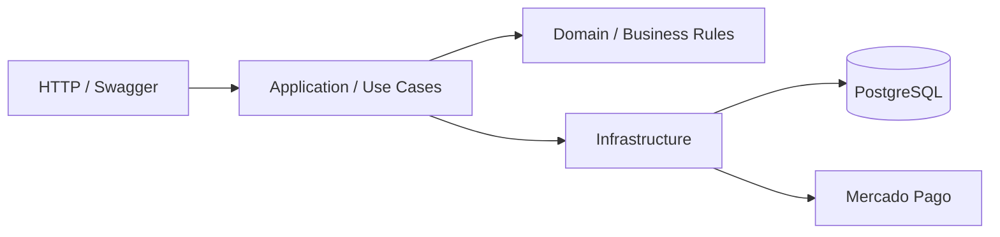

# Payment Lifecycle API

REST API for managing payment lifecycles with PIX and credit card payments.

Integrates with Mercado Pago Checkout Pro for credit card payments and uses validated webhooks to process payment status updates.


## Stack


## Overview

A backend project developed to explore payment processing, external provider integrations, and reliable transaction management.

The application focuses on request idempotency, payment state management, webhook validation, and separation of business rules from infrastructure.

## Architecture



## Key Features

- PIX and credit card payment methods
- CPF and request validation
- Request idempotency through `Idempotency-Key`
- Payment lifecycle management
- PostgreSQL persistence with Prisma migrations
- Mercado Pago Checkout Pro integration
- Webhook signature validation
- Unit tests for core use cases
- Swagger API documentation

## Prerequisites

Make sure Docker and Docker Compose are installed and the Docker engine is running.

A Mercado Pago integration requires the appropriate credentials and webhook configuration.

## Run Locally

1. Clone the repository:

```bash
git clone git@github.com:USERNAME/REPOSITORY.git
cd REPOSITORY
```

2. Create your environment file:

```bash
cp .env.example .env
```

3. Configure the required values:

```env
MERCADO_PAGO_ACCESS_TOKEN=
MERCADO_PAGO_WEBHOOK_SECRET=
MERCADO_PAGO_WEBHOOK_URL=
```

4. Start the application:

```bash
docker compose up --build
```

- API: `http://localhost:3000`
- Health: `http://localhost:3000/health`
- Swagger: `http://localhost:3000/api/docs`

## Endpoints

| Method | Route | Description |
| --- | --- | --- |
| `POST` | `/api/payment` | Create a payment |
| `GET` | `/api/payment` | List payments |
| `GET` | `/api/payment/:id` | Get payment by ID |
| `PUT` | `/api/payment/:id` | Update payment status |

## External Integrations

| Service | Purpose | Protocol |
| --- | --- | --- |
| Mercado Pago | Credit card checkout | REST |
| Mercado Pago Webhooks | Payment status notifications | HTTP |
| PostgreSQL | Payment persistence | PostgreSQL |

### Provider Callback

| Method | Route | Description |
| --- | --- | --- |
| `POST` | `/api/webhooks/mercado-pago` | Mercado Pago webhook callback |

## Example Requests

### Create a PIX Payment

```bash
curl -X POST http://localhost:3000/api/payment \
  -H "Content-Type: application/json" \
  -H "Idempotency-Key: pix-payment-001" \
  -d '{
    "cpf": "52998224725",
    "description": "PIX payment",
    "amount": 35.50,
    "paymentMethod": "PIX"
  }'
```

### Create a Credit Card Checkout

```bash
curl -X POST http://localhost:3000/api/payment \
  -H "Content-Type: application/json" \
  -H "Idempotency-Key: credit-card-payment-001" \
  -d '{
    "cpf": "52998224725",
    "description": "Credit card payment",
    "amount": 12.34,
    "paymentMethod": "CREDIT_CARD"
  }'
```

The response includes a `checkoutUrl` for Mercado Pago Checkout Pro.

## Tests and Build

Run unit tests:

```bash
docker compose exec api npm test -- --runInBand
```

Build the application:

```bash
docker compose exec api npm run build
```

## Technical Highlights

- Layered architecture and separation of responsibilities
- Request validation and business rule enforcement
- Idempotent payment creation
- Payment status management through validated webhooks
- Database persistence and schema migrations
- Integration with an external payment provider
- Automated unit testing
- API documentation with Swagger
